  

  <h1>
    Patrick Bumüller
  </h1>
  

    <em>aka <strong>bumbum</strong>  &bull; Software Engineer</em>
  

  

    Currently playing around with automation, containerization, and developer tooling.
  

  

    
  

---

### 🛠 Cloud, Containers & Infrastructure

### 💻 Languages & Scripting

---

### 📊 GitHub Activity & Stats

  
  

### 🐍 Contribution Graph

<picture>
  <source media="(prefers-color-scheme: dark)" srcset="./profile/github-contribution-grid-snake-dark.svg">
  <source media="(prefers-color-scheme: light)" srcset="./profile/github-contribution-grid-snake.svg">
  
</picture>
